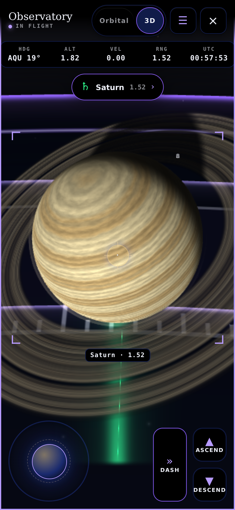
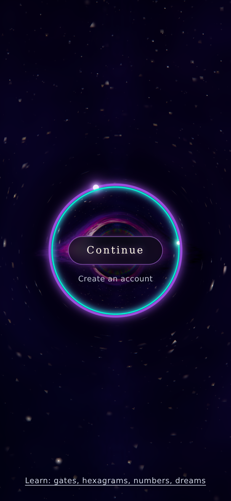

# Globe graphics CPU cost: restart validation

The branch reuses eight vectors and one quaternion for ring normals and comet tail orientation. It adds no GPU resources and clears the CPU workspace on destruction. All 240 controlled orientation comparisons match the old implementation exactly. The lifecycle gate fails when the old update function is substituted, and passes 87 checks on this branch.

The first controlled Node benchmark, median of seven batches of 20,000 warmed updates, measured 36.31ms before and 24.25ms after. A repeat during the restart measured 31.99ms and 21.70ms. Tracked vector/quaternion allocations were 420,000 before and zero after in both runs. These timings describe the isolated update function, not an app FPS gain, and do not count closures or three.js internal allocations.

## Required gates

| Command | Result |
|---|---|
| node tools/build-bundle.js | built, 61/61 modules |
| node tools/run-tests-node.js | 43/43, 12 browser-only rows skipped |
| node tools/run-fixtures.js | 9/9 |
| node tools/run-module-tests.js | 435/435 |
| node tools/check-dead-controls.js | pass, 1442 handler holes, 60 dialogs |
| node tools/check-purple-text.js | pass, zero disallowed violet text sites |
| node tools/token-compare.js | pass, 55 tokens agree where required |
| node tools/check-layer-boundary.js | pass, 67 modules |
| node tools/check-three-lifecycle.js | 87 checks pass |
| node tools/drive-cover.js | 3/3 |
| node tools/drift-check.js --force --with-h | all eight phases pass |
| node tools/build-bundle.js --check | pass |

The forced sweep with H includes every phase of the plain forced sweep.

| Browser phase | Passed |
|---|---|
| M | 90/90 |
| E | 5/5 |
| F | 16/16 |
| G | 35/35 |
| T | 64/64 |
| R | 14/14 |
| N | 58/58 |
| H | 17/17 |

H read a 900x640 drawing buffer, maximum channel 223, 97.8 percent lit. The complete runner output is in [drift-check.log](drift-check.log); the cover control output is in [drive-cover.log](drive-cover.log). The sweep took 634.6 seconds, with H finishing after about 398 seconds. No tests or thresholds were weakened, and no source shader or vendored library was edited.

## Actual stage, emulated phone profile

390x844 CSS pixels, DPR 2, CPU slowdown 4x, Chromium 153 with SwiftShader. The source app opened Observatory in 3D, flew to Saturn and waited for autopilot to settle. After 20 settling draws, 60 frame intervals were sampled. The before run intercepted only body-globes.js with its unchanged main implementation. Both runs used fresh browser contexts, the app's sample profile and blocked external service calls. Fonts therefore used their available local fallbacks.

| Observation | Before | After |
|---|---|---|
| Median frame interval | 78.4ms | 68.4ms |
| 95th percentile | 176.8ms | 107.1ms |
| Settled stage rung | 4 | 4 |
| Drawing buffer | 292x633 | 292x633 |
| Globe count | 7 | 7 |
| Renderer geometry count | 14 | 15 |
| Renderer texture count | 40 | 40 |
| Draw calls | 44 | 44 |
| Triangles | 26,470 | 26,470 |

These single software-rendered samples are noisy and do not establish an FPS gain. The geometry counter differs by one across the independent runs, so the memory comparison is inconclusive. The change contains no new geometry, material, texture or render target allocation. Renderer object counts are not GPU bytes. Hardware GPU memory and physical phone frame pacing remain unmeasured; the full before/after performance acceptance is still open.

## Bottom cover rung

The same phone profile forced rung 8 in a served copy of cover.html and disabled promotions in that copy. Production files and the nine-rung ladder were unchanged. The screenshot waited for body.live, the veil to clear and the mark wrapper to finish revealing. Drawing-buffer readback, taken in an animation frame, found 99.2965 percent of pixels above intensity 8, maximum channel 238 and GL error 0, with no page errors. The buffer was 780x1688; the rung was scale 0.28 and 62 steps. The disk, sky, ring and Continue pill are visible.

The JSON files beside these screenshots retain the unrounded observations.

## Runtime and review limits

Regular Playwright downloads returned invalid ZIPs. A temporary @sparticuz/chromium 153.0.0 installation provided Chromium 153.0.8010.0. Its Brotli executable was extracted with a stream after a direct write produced a truncated executable. SwiftShader libraries were placed beside it. A launcher selected ANGLE with SwiftShader, adapting this Chromium to the runner's older graphics flags. The runner ran unchanged, with a local static server in the same process. No browser dependency was added to the application.

Haiku 5.5 and Nemotron 3.5 Lightening were unavailable in this session. These are the primary agent's results. Independent review, hardware GPU memory and repeatable device frame pacing remain outstanding. No production service was changed.
