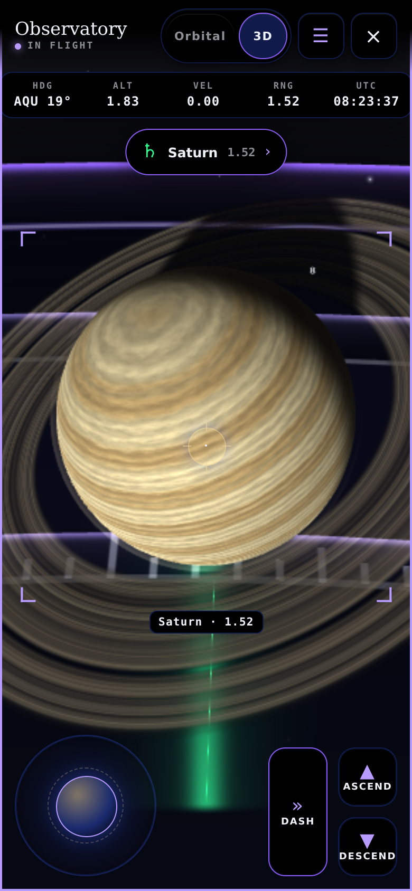
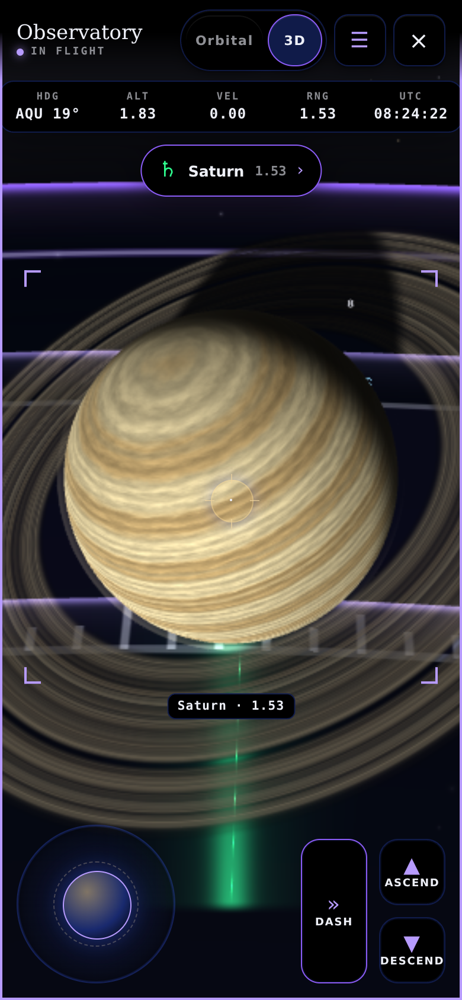
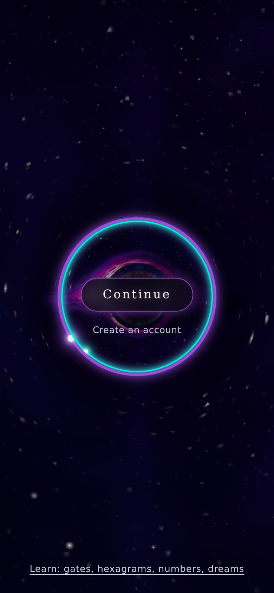

# Stage quality history and Cycle Audit cleanup

Returning to a 3D stage could combine late frames from separate visits and
unnecessarily lower its quality. The chart, Human Design and Cycle Audit
stages now clear both the average samples and consecutive late-frame count
when the loop starts or resumes. An idle draw breaks the late-frame streak.
Cycle Audit also releases its three owned shared geometries even when no
mesh in the scene graph refers to them. Release uses the existing deduplicated
teardown after shader warm-up settles, including rejected warm-up jobs.

Recovered from closed, unmerged PR #95 and rebased onto main
`c259e80708bc25fef46d7ce4fd064c67c9fcba75`. The globe CPU reuse work from
merged PR #97 is already in this base and is not duplicated. Source commit
under test: `937ab3e40cdf76eab5b6427b03918ebed53af82e`. Later documentation
and evidence changes do not change the tested source or bundle bytes.

## Controlled behavior

Production methods are loaded in a Node VM from current main and this branch.
All three stages give the same results, starting at level 0:

| Input | Before | After |
|---|---|---|
| Two busy 150ms draws, restart, one busy 150ms draw | level 1 | level 0 |
| Two busy 150ms draws, idle 32ms draw, one busy 150ms draw | level 1 | level 0 |
| Three consecutive busy 150ms draws within one visit | level 1 | level 1 |

The third row is held by the lifecycle gate. That gate passes 103 checks,
covering startup/resume quality resets, idle streak breaks, owned geometries,
deduplication and cleanup deferred until warm-up resolves or rejects. Removing
each of the six quality corrections and each of the three Cycle Audit releases
separately triggers the expected AssertionError: 9/9 mutations caught.
See [quality-probe.json](quality-probe.json),
[mutation-results.json](mutation-results.json) and
[check-three-lifecycle.log](check-three-lifecycle.log).
These controlled tests are not phone frame-rate measurements.

## Phone-profile observations

Chromium 153 with SwiftShader, 390x844 CSS pixels, DPR 2, CPU slowdown 4x.
Each variant starts a fresh browser, opens the sample Observatory in 3D,
flies to Saturn, waits for autopilot to settle, stops and restarts the stage,
then records 60 frame intervals after 20 settling draws. The before variant
serves only the three scene modules from current main. Both variants use the
current shell and the already-merged globe math. External requests are blocked;
fonts use the available local fallbacks. Runs are sequential and separate from
other browser workloads.

| Observation | Before | After |
|---|---|---|
| Median draw interval | 72.0ms | 72.3ms |
| 95th percentile | 203.3ms | 217.0ms |
| Settled chart rung | 4 | 4 |
| Drawing buffer | 292x633 | 292x633 |
| Active globes | 7 | 7 |
| Renderer geometries | 14 | 14 |
| Renderer textures | 40 | 40 |
| Draw calls | 44 | 44 |
| Triangles | 26,470 | 26,470 |
| Points / lines | 1,100 / 260 | 1,100 / 260 |
| Hardware GPU bytes | unmeasured | unmeasured |

This single software-rendered pair does not establish a frame-rate gain or a
hardware memory saving. Renderer object counts are not GPU bytes. The chart
was already at the bottom stage rung in both runs, so these observations do
not demonstrate quality retention on faster devices. HD and Cycle browser
frame pacing, physical-phone performance and hardware GPU crash/recovery are
unmeasured. Their quality-history behavior is covered by the controlled tests.

The two phone-stage JSON files preserve the unrounded observations.

## Bottom-rung cover

A served-only copy of cover.html starts at rung 8 and prevents adaptive rung
changes. All nine production quality rungs and their floor remain unchanged.
At the same phone profile the probe waits for body.live, the veil to clear,
and the ring wrapper to reveal before taking a screenshot. Drawing-buffer
readback in an animation frame finds 99.2952 percent of pixels above intensity
8, maximum channel 239, GL error 0 and no page errors. The 780x1688 output
buffer contains a rung-8 render at scale 0.28 and 62 steps. The output buffer
size is not the internal raymarch target size. The sky, disk, ring and Continue
pill are visible. This is pixel evidence beyond the __EH_LIVE flag.

See [cover-rung8-phone.json](cover-rung8-phone.json) for readback data.

## Required gates

Results for the fresh run on the rebased branch are recorded in the individual
logs and [gate-results.json](gate-results.json). The interrupted earlier drift
runs have no completed result and are not counted as passes.

| Command | Result |
|---|---|
| node tools/build-bundle.js | built, 61/61 modules |
| node tools/run-tests-node.js | 43/43, 12 browser-only checks skipped |
| node tools/run-fixtures.js | 9/9 |
| node tools/run-module-tests.js | 435/435 |
| node tools/check-dead-controls.js | pass, 1,442 handler holes, 60 dialogs |
| node tools/check-purple-text.js | pass, zero disallowed violet text sites |
| node tools/token-compare.js | pass, 55 tokens agree where required |
| node tools/check-layer-boundary.js | pass, 67 modules |
| node tools/check-three-lifecycle.js | 103 checks passed |
| node tools/build-bundle.js --check | pass |
| node tools/drive-cover.js | 3/3 |
| node tools/drift-check.js --force --with-h | all eight phases passed |

The forced sweep with H includes all phases of the plain forced sweep.

| Browser phase | Passed |
|---|---|
| M | 90/90 |
| E | 5/5 |
| F | 16/16 |
| G | 35/35 |
| T | 64/64 |
| R | 14/14 |
| N | 58/58 |
| H | 17/17 |

H read the complete 900x640 drawing buffer: maximum channel 223, 97.8 percent
lit. The full sweep completed in 697.0 seconds, including about 480.3 seconds
for H. These are fresh results from this branch, not inherited from PR #97.
See [drift-check.log](drift-check.log) for the full run output and
[validation-manifest.json](validation-manifest.json) for tested file hashes.
The Node log prints six legacy test names with U+2014 glyphs. This committed
log renders those glyphs as [U+2014] to comply with the repository's no-dash
rule. No test result or assertion was changed. Original output SHA256:
`040f33584934329d8a9271ac1d11dbb96c780f4a3b928c94bf5405e84bc84f18`.

## Reproduction and limits

The probes in [probes/](probes/) locate the repository relative to themselves.
Run them from the repo root with the runtime Playwright dependency available
through CODEX_PRIMARY_RUNTIME_NODE_MODULES and a Chromium launcher selected
by DRIFT_CHECK_CHROMIUM. Run stage-phone-probe.cjs with before and after in
separate sequential runs. Its baseline is origin/main, so pin that ref to the
base SHA above when reproducing these numbers. The mutations and quality
probes do not need a browser.

The temporary browser is @sparticuz/chromium 153.0.0, Chromium 153.0.8010.0.
Its Brotli executable was streamed to a complete 209,022,176-byte file, with
SwiftShader libraries beside it. A launcher selects ANGLE and SwiftShader.
A temporary loopback static server served the repository on port 8099 during
the gates. To reproduce the browser sweep, serve the repo root on that port
and run the drift command with NODE_PATH pointing to Playwright and
DRIFT_CHECK_CHROMIUM pointing to the launcher. No application dependency,
repository runner or vendored file was changed.
The unmodified drift runner extends the H runner's timeout only in its served
copy, as it already does for software rendering. No test threshold was changed.

The three startup draws, stage quality levels, thresholds, 2D-first opening,
prebuilt stages, loading veils, reduced-motion behavior and warm-up order are
preserved. The patch adds no GPU resources. No cover shader constants or ring
colors were changed. No production service was modified and no owner dashboard
action is needed.

The supplied 00-README.md was read from the owner's uploaded copy before work.
It is absent from main; its gate and ownership requirements are applied here.
Haiku 5.5 and Nemotron 3.5 Lightening were unavailable. These are the primary
agent's verification results; independent review remains outstanding.
